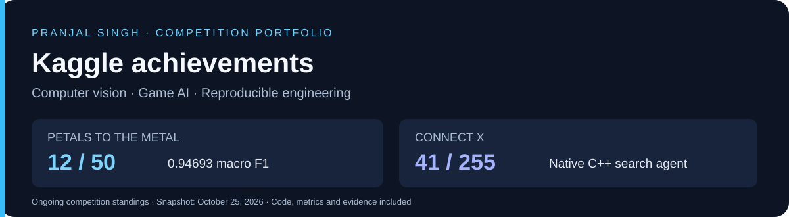
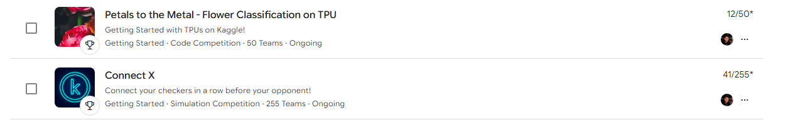

<p align="center"></p>

# Kaggle competition achievements

**Pranjal Singh** · [Kaggle profile](https://www.kaggle.com/pranjalsinggh) · [GitHub profile](https://github.com/pranjalsinggh) · [Resume bullets](docs/RESUME.md)

Two implemented and submitted competition projects: an ensemble for 104-class flower classification and a native search agent for Connect Four. This repository brings together the leaderboard evidence, methods, source code, notebooks, and measured results.

## Results at a glance

| Competition | Achieved leaderboard position | Rank / team count | Measured result | Project |
|---|---:|---:|---|---|
| [Petals to the Metal](https://www.kaggle.com/competitions/tpu-getting-started) | **12th of 50 teams** | 24.0% | **0.94693 macro F1** on Kaggle | [Computer vision case study](projects/petals-to-the-metal/README.md) |
| [Connect X](https://www.kaggle.com/competitions/connectx) | **41st of 255 teams** | 16.1% | Accepted native C++/Python agent | [Game AI case study](projects/connect-x/README.md) |

**Standings snapshot: October 25, 2026.** Both are ongoing Kaggle Getting Started competitions. Ranks and team counts can change. The rank/team percentages above are simple ratios, not Kaggle percentile awards. These are leaderboard achievements, not final placements, medals, or competition wins. The flower competition's title mentions TPU; this implementation trained on **two NVIDIA T4 GPUs**.



## 1. Petals to the Metal — flower classification

Built an ImageNet transfer-learning pipeline with **EfficientNetV2S and EfficientNetB3**, TensorFlow/Keras, mixed precision, and two-GPU training. The task predicts one of **104 flower classes** for **7,382 test images**.

- Trained on **12,753** official training images; held out the **3,712** supplied validation images for checkpoint and blend selection.
- Used **331 × 331** inputs, image augmentation, label smoothing, cosine learning-rate decay, and checkpoint selection by validation macro F1.
- Averaged four image views per model and selected a **50/50 probability blend** from a five-weight validation comparison.
- Recorded **0.95479 validation macro F1** for the selected blend and **0.94693 Kaggle macro F1**, reaching **12/50** in the supplied snapshot.
- Joined predictions to the official template by image ID and checked every test ID, probability array, and class range before submission.

| Model | Validation macro F1 after view averaging | Accepted Kaggle macro F1 |
|---|---:|---:|
| EfficientNetB3 | 0.94559 | 0.94041 |
| EfficientNetV2S | 0.94827 | 0.94451 |
| **Equal probability blend** | **0.95479** | **0.94693** |

The blend's validation score was used for model selection; it is distinct from the independently scored Kaggle submission. [Read the full method, validation procedure, and reproduction steps →](projects/petals-to-the-metal/README.md)

## 2. Connect X — native game-playing agent

Built a **C++17 bitboard search engine** with a Python `ctypes` entry point for Kaggle's 7-column, 6-row Connect Four environment. The submitted agent uses a **1.45-second search budget per move**, iterative deepening, alpha-beta pruning, tactical threat handling, and a transposition table.

- Reached **41/255 teams** in the supplied October 25 snapshot.
- Passed **308 generated position checks** against Kaggle's official game helpers and completed a full self-play draw through the official Python-file agent loader.
- Won **8/8 games against random** and **8/8 against the built-in negamax baseline** in small seeded benchmarks at a 0.045-second search budget.
- In one sampled Kaggle invocation, searched **5,748,736 nodes** to completed **depth 18** in **1.479 seconds**.
- Packaged a Linux shared library with the Python entry point; no NumPy, Numba, runtime compilation, network access, or external game data is required by the agent.

The small baseline benchmarks and sampled timing are engineering measurements, not guarantees against leaderboard opponents. [Read the search architecture, testing evidence, and build steps →](projects/connect-x/README.md)

## Explore the repository

```text
assets/                         Leaderboard proof, score evidence, learning curves
docs/RESUME.md                  Copyable achievement and project bullets
docs/EVIDENCE.md                Claim-to-evidence map and dated result provenance
projects/petals-to-the-metal/   Training sources, importable notebooks, reports
projects/connect-x/            C++ engine, Python wrapper, Linux artifact, validation
results/achievements.json      Machine-readable snapshot of both achievements
```

## Technical skills demonstrated

**Computer vision:** transfer learning, multiclass evaluation, GPU training, TensorFlow data pipelines, augmentation, test-time averaging, probability ensembles, validation discipline.

**Game AI and systems:** bitboards, adversarial search, alpha-beta pruning, iterative deepening, transposition tables, Python/native interop, cross-compilation, constrained-runtime deployment, correctness and timing validation.

## Reproduce and inspect

Follow the project-specific guides: [flower pipeline](projects/petals-to-the-metal/README.md#reproduction) · [Connect X build and validation](projects/connect-x/README.md#reproduction).

Competition data and large flower model checkpoints are not redistributed here. Obtain data through Kaggle under the applicable competition rules. Kaggle notebook links provide additional provenance; private notebook outputs require owner access. The public repository includes the code and saved reports needed to inspect the methods without that access.

Original project code is available under the [MIT license](LICENSE). Bundled native third-party components retain their [license notices](projects/connect-x/THIRD_PARTY_NOTICES.txt).
