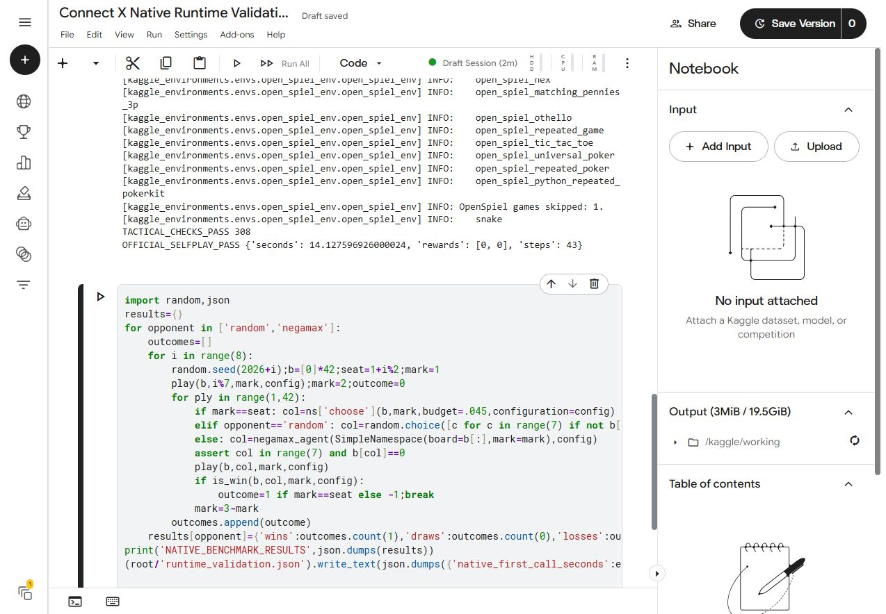
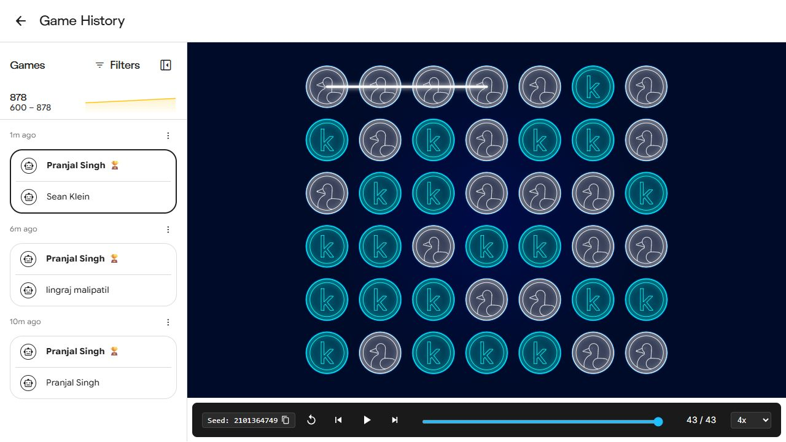

# Connect X — native Connect Four search agent

[← Portfolio overview](../../README.md) · [Competition](https://www.kaggle.com/competitions/connectx) · [Leaderboard](https://www.kaggle.com/competitions/connectx/leaderboard)

**Achievement: 41st of 255 teams** in the supplied October 25, 2026 Kaggle screenshot (rank/team ratio 16.1%). This is an ongoing simulation competition; rank changes as Kaggle schedules rated games. The later screenshot supersedes the earlier 55/251 snapshot in the development records. A rating corresponding to the later 41/255 standing was not recorded.

## Task and runtime

Choose legal moves in standard Connect Four: seven columns, six rows, four connected pieces to win. Kaggle invokes a Python entry point with the board observation and game configuration. The engine evaluates the current position within a fixed CPU time budget.

The accepted package contains `main.py` and `libconnectx.so` at its root. Python loads the bundled C++ shared library through `ctypes`. The submitted agent does not require NumPy, Numba, network access, compilation, or external game data at runtime.

## Search architecture

| Component | Implementation |
|---|---|
| Board representation | 64-bit bitboards with seven bits per column, including a sentinel bit |
| Search | Negamax with alpha-beta pruning |
| Time management | Iterative deepening; retain the best move from the last fully completed depth |
| Move budget | 1.45 seconds; clock checked every 2,048 search nodes |
| Tactical handling | Immediate wins, forced blocks, double-threat losses, filtering moves that enable an immediate opponent win |
| Transposition table | 2²¹ indexed entries with position key, score, depth, bound type, and preferred move |
| Move ordering | Cached preferred move, generated winning threats, center preference, prior root scores |
| Heuristic | Open four-cell lines, weighted piece counts, center occupancy, and potential winning squares |
| Integration | C ABI exported by C++17; Python standard-library `ctypes` wrapper |

The engine explicitly handles terminal or forced tactical positions before expanding the full search. Iterative deepening provides a legal fallback when the time budget is reached. The code targets standard 7 × 6, connect-four play; the wrapper uses a simple legal move fallback for other configurations.

## Observed validation

Tests were executed in a Kaggle CPU notebook on Linux x86_64, glibc 2.39, Python 3.13.15. The compiled library targets a glibc 2.17 baseline.

| Check | Recorded result |
|---|---|
| Generated board checks against official Kaggle helpers | 308 passed |
| Official Python-file agent loader, self-play | Completed 42-move draw; both agents `DONE` |
| Seeded games vs random baseline | 8 wins, 0 draws, 0 losses |
| Seeded games vs built-in negamax baseline | 8 wins, 0 draws, 0 losses |
| Benchmark search budget | 0.045 seconds per move |
| Sampled first invocation with submitted budget | 1.479129398 seconds |
| Completed depth in that invocation | 18 |
| Nodes searched in that invocation | 5,748,736 |

The small benchmark used both seats across seeded openings. The sampled timing applies to that invocation and machine, not every board or runtime. These checks establish functional and runtime evidence; the actual 41/255 standing comes from the separate leaderboard screenshot.



## Deployment work

The earlier Python/Numba entry failed because the competition environment paired an incompatible Numba version with NumPy 2.4. Moving search into a precompiled native library removed that dependency. The corrected native archive was validated in Kaggle's CPU environment, then accepted by the competition validator.

The source-included archive `submission-licensed.zip` carries the executable, original source, and license notices. It contains the same executable as the accepted minimal native archive.

The early recorded rated games were two wins and one draw, with ratings 732.7, 878.2, and 862.0 after those games. That partial game history predates the October 25 ranking and is not the complete lifetime match record.



## Reproduction

Build on a machine with the PyPI-distributed Zig toolchain used for the original cross-compilation:

```sh
python -m pip install ziglang==0.16.0
python -m ziglang c++ search.cpp -target x86_64-linux-gnu.2.17 -O3 -std=c++17 -fPIC -shared -o libconnectx.so
```

Run validation on **Linux x86_64** (or the Kaggle CPU runtime), from this directory:

```sh
python -m pip install kaggle-environments
python validate_native.py
```

The validation harness reuses the original official-helper tests while loading the explicit local artifact instead of embedding its bytes in a notebook. It writes a new report under `validation-output/`; the committed report records the original observed run. Dependencies may evolve, so rerun compatibility checks before a new submission.

Upload `submission-licensed.zip` to the competition, or package the freshly built `main.py`, `libconnectx.so`, source, and license files at the archive root. The Linux shared library will not load directly in Windows Python; cross-compilation on Windows produces the Linux submission artifact.

Original validation notebook: [Connect X Native Runtime Validation](https://www.kaggle.com/code/pranjalsinggh/connect-x-native-runtime-validation). Notebook visibility may require owner access.

## Files and licensing

`search.cpp` and `main.py` are original project source under the repository MIT license. The native artifact includes LLVM libc++ components; preserve `THIRD_PARTY_NOTICES.txt` when redistributing. `reports/runtime_validation.json` is the observed test record, and `../../results/achievements.json` records the later ranking evidence.
