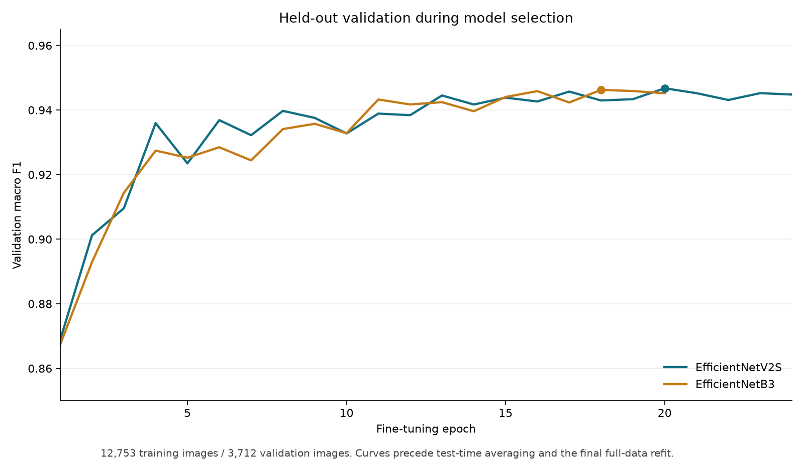
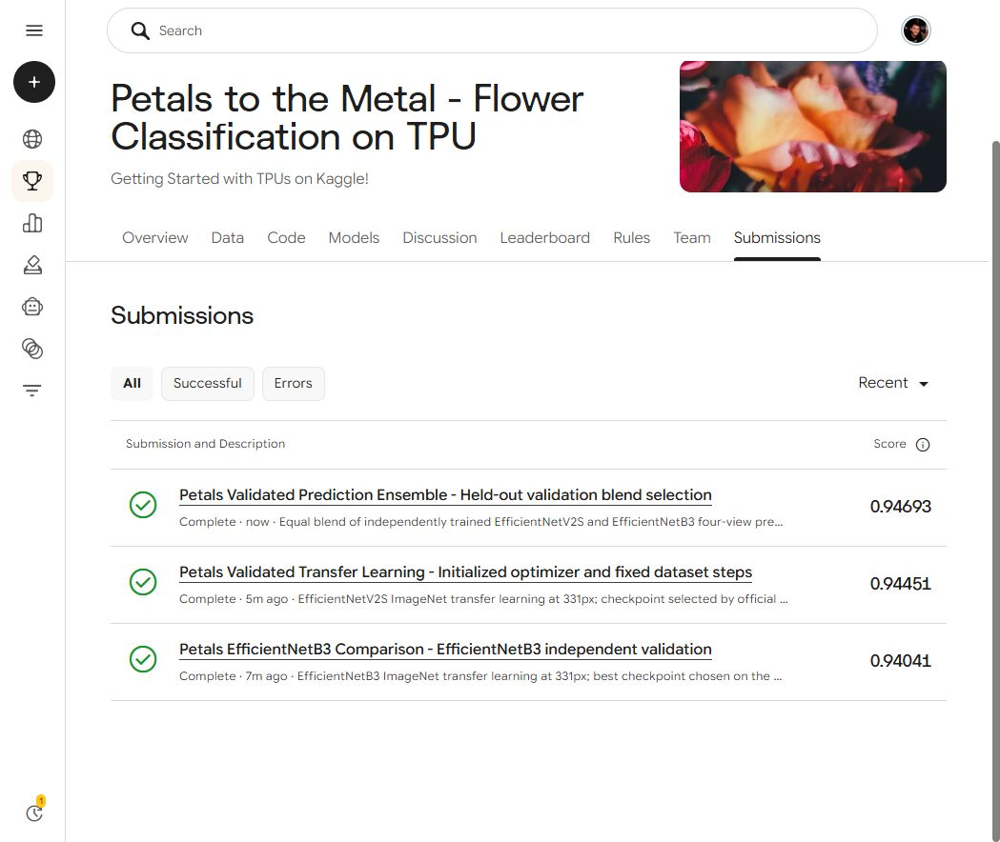

# Petals to the Metal — 104-class flower classification

[← Portfolio overview](../../README.md) · [Competition](https://www.kaggle.com/competitions/tpu-getting-started) · [Leaderboard](https://www.kaggle.com/competitions/tpu-getting-started/leaderboard)

**Achievement: 12th of 50 teams, with an accepted Kaggle score of 0.94693 macro F1.** Rank is from the October 25, 2026 screenshot in this repository; the competition is ongoing.

## Problem and data

Predict a flower category across 104 classes from JPEG images supplied in TFRecords. The official split used here contains 12,753 training images, 3,712 validation images, and 7,382 unlabeled test images. Images were read from Kaggle's `tfrecords-jpeg-331x331` input.

The official validation split stayed out of gradient-based training for the models behind this reported score. Test labels were not used. ImageNet-pretrained backbones provide transfer learning.

## Model and training design

| Setting | EfficientNetV2S | EfficientNetB3 |
|---|---|---|
| Initialization | ImageNet | ImageNet |
| Input | 331 × 331 RGB, original 0–255 scale | 331 × 331 RGB, original 0–255 scale |
| Preprocessing | Keras built-in, enabled | Keras built-in |
| Head | Global-average-pooled backbone, dropout 0.3, 104-way softmax | Same head design |
| Frozen-backbone warm-up | 2 epochs, Adam 0.001 | 2 epochs, Adam 0.001 |
| Fine-tuning | 24 epochs | 20 epochs |
| Fine-tuning learning rate | Cosine schedule, 1e-4 to 1e-6 | Same schedule |
| Batch size | 64 total across two GPUs | 64 total across two GPUs |
| Precision | Mixed float16; float32 softmax | Same |
| Seed | 20261023 | 20261024 |

Training used TensorFlow `MirroredStrategy` on two NVIDIA T4 GPUs. Batch-normalization layers stayed frozen during fine-tuning, and the backbone was called with `training=False`. Loss was categorical cross-entropy with label smoothing 0.05. Best checkpoints were selected using validation macro F1, with early stopping patience 6.

Augmentation combines random square crops (78–100% of the image side), resizing, horizontal and vertical flips, rotations in multiples of 90°, and brightness, contrast, and saturation changes. The `tf.data` pipeline caches decoded examples and prefetches batches.

An early multi-GPU initialization issue was resolved by explicitly building optimizer state for the trainable variables, asserting dataset cardinality, and using one step per compiled execution. These details are included in the source.

## Evaluation and ensembling

For each model, validation and test probabilities average four deterministic views: original, horizontal flip, vertical flip, and 180° rotation. Deterministic record order preserves prediction alignment.

| Model | Validation macro F1 | Validation accuracy | Accepted Kaggle macro F1 |
|---|---:|---:|---:|
| EfficientNetB3 | 0.9455887 | 0.9450431 | 0.94041 |
| EfficientNetV2S | 0.9482700 | 0.9504310 | 0.94451 |
| **50/50 blend** | **0.9547906** | Not separately recorded | **0.94693** |

The blend weights were selected from a preset grid. `w` below is the B3 weight; V2S receives `1 − w`.

| B3 weight | Validation macro F1 |
|---:|---:|
| 0.00 | 0.9482700 |
| 0.25 | 0.9510366 |
| **0.50** | **0.9547906** |
| 0.75 | 0.9476352 |
| 1.00 | 0.9455887 |

The accepted blend improved Kaggle macro F1 by **0.00242 absolute** over the V2S-only submission. The validation set informed both checkpoint and blend selection, so its score is a model-selection metric rather than an untouched final holdout estimate. Macro F1 is not accuracy.

A later class-prior calibration experiment used three stratified validation folds and a consistency guard. No tested setting improved all three folds, so calibration was rejected and was not submitted. The corresponding source and report are included for transparency.

## Submission integrity

- Check that all 7,382 test IDs are unique and match the official sample submission.
- Require finite probabilities and the expected number of rows/classes.
- Align the two models by test ID before blending and verify identical validation labels.
- Write labels in the official sample-submission order and require the class range 0–103 with no missing values.

## Reproduction

1. Join the competition and attach its data to a Kaggle notebook under the competition rules.
2. Select **GPU T4 x2**. Import `notebooks/petals_training.ipynb` for V2S or `notebooks/petals_b3_comparison.ipynb` for B3. The matching scripts are in `src/`.
3. Save and run each training notebook. Outputs include best weights, validation probabilities, test probabilities, training CSV, validation report, and submission CSV.
4. Attach both successful notebook outputs plus the competition input to `notebooks/petals_ensemble.ipynb`. Run it on CPU to select the validation blend and generate `submission.csv`.
5. Submit the saved ensemble output through Kaggle. Current runtime/package versions and available hardware may differ from the original runs.

Runtime dependencies: TensorFlow/Keras, NumPy, pandas, and scikit-learn. Use the Kaggle GPU image; installing a CPU-only TensorFlow environment does not reproduce the training hardware.

### Original run provenance

| Artifact | Kaggle saved version |
|---|---|
| V2S training | [361483897](https://www.kaggle.com/code/pranjalsinggh/petals-validated-transfer-learning?scriptVersionId=361483897) |
| B3 training | [361490733](https://www.kaggle.com/code/pranjalsinggh/petals-efficientnetb3-comparison?scriptVersionId=361490733) |
| Scored ensemble | [362195726](https://www.kaggle.com/code/pranjalsinggh/petals-validated-prediction-ensemble?scriptVersionId=362195726) |
| Rejected calibration experiment | [362196936](https://www.kaggle.com/code/pranjalsinggh/petals-validated-prediction-ensemble?scriptVersionId=362196936) |

Notebook visibility may require owner access. Local saved reports provide the recorded metrics. Large trained weights, probability arrays, competition data, and subsequent unscored full-data refit experiments are excluded from this achievement snapshot.
